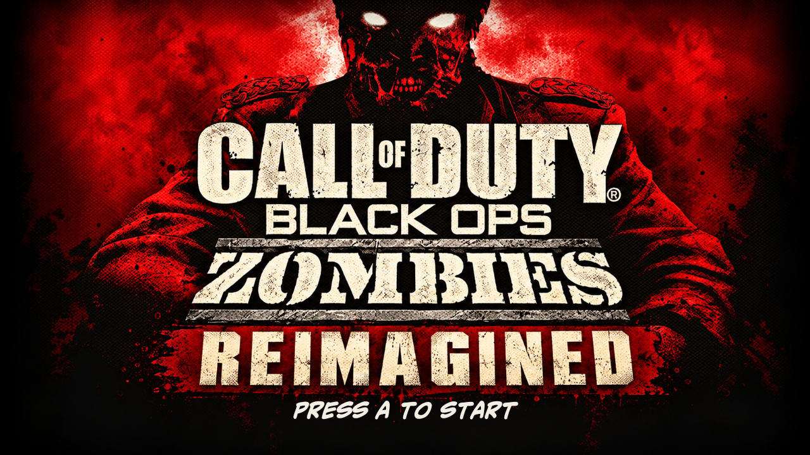
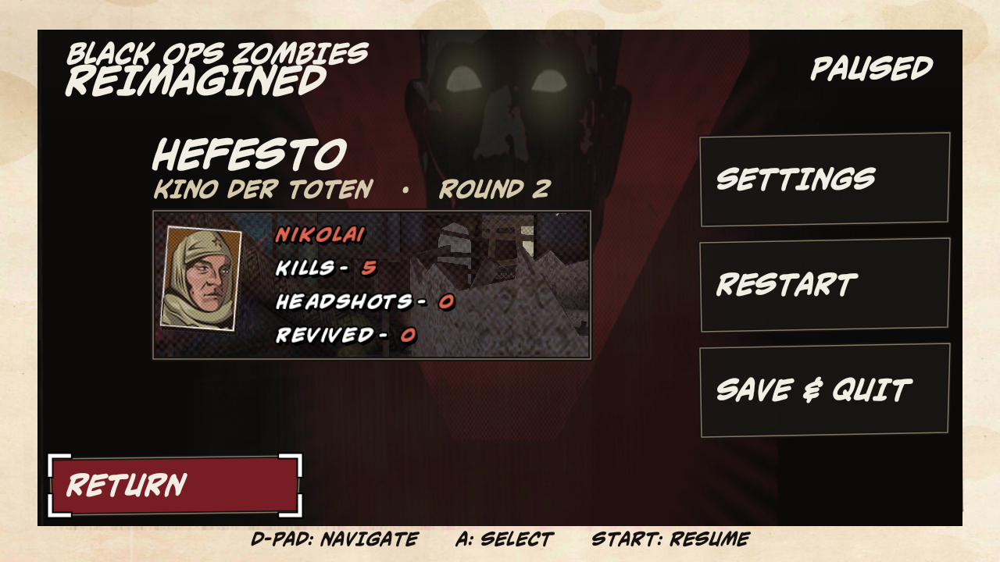
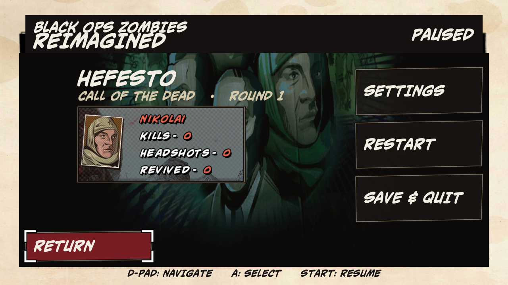
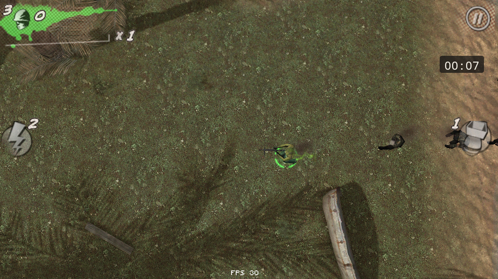
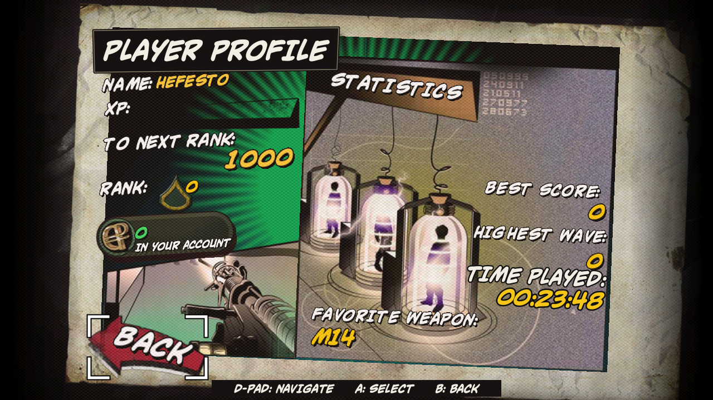

# BOZ Reimagined

[English](README.md) · **Português**

**Call of Duty: Black Ops Zombies** (Android 1.0.11) adaptado para **Android TV**: jogável do início ao fim com controle,
sem HUD de toque, com o layout de botões do Black Ops 1 de console e menus redesenhados no estilo de quadrinhos do jogo.

<p align="center"></p>

> Projeto de fã, sem fins lucrativos e sem ligação com a Activision.
> *Call of Duty* e *Call of Duty: Black Ops Zombies* são marcas registradas e propriedade da **Activision Publishing, Inc.**
>
> O jogo foi **retirado da Google Play** e não é mais vendido. **Este repositório não contém o jogo** (nenhum APK, OBB,
> binário ou música originais) e nunca vai conter. O patch das Releases só funciona aplicado sobre a sua própria cópia
> do APK: sem o jogo original, não há como usar este projeto. Não peça os arquivos nas issues.

## Capturas (TV real, 1280×720)

| Pause com dados da partida (Kino der Toten) | Pause com o cenário do mapa (Call of the Dead) |
|---|---|
|  |  |
| **Dead Ops Arcade com timer de partida** | **Player Profile com nome e TIME PLAYED** |
|  |  |

## O que muda

**Controle (padrão Xbox)**
- Analógicos para mover e mirar, gatilhos para atirar e mirar com a arma (a mira deixou de ser de segurar e passou a alternar), X para recarregar.
- Granadas e táticos como no BO1: direcional direito para a claymore e LB para o outro tático (Monkey Bomb, Gersh, Matryoshka).
- Todos os menus são navegáveis pelo D-pad, com foco em cantoneiras e transições que escondem o SWF original.

**Menus e interface**
- Título "Reimagined", menu principal, seleção de personagem e mapa, Single Player, New Game, Quit, Save & Quit,
  Pause e Game Over redesenhados (camada Java por cima do jogo).
- Editor de nome pelo controle; o nome aparece no Player Profile, no pause e no lobby do co-op.
- O pause mostra jogador, mapa, round e estatísticas; o Start também pausa o Dead Ops.
- Timer de partida com a fonte do HUD (liga/desliga no pause) e TIME PLAYED no Player Profile.
- COD Points, More Apps e compras removidos.

**Jogabilidade (patches no binário)**
- Ondas e drops no ritmo do BO1: ciclo de drops sem repetição, Carpenter só com janelas quebradas,
  Death Machine só com energia ligada ou depois de alguém ter tido Quick Revive, DG-2 só depois de matar o George.
- Dead Ops Arcade liberado desde o início; a morte vai direto ao Game Over.
- Limite estável de 30 FPS e contador de FPS.
- Correções: o zumbi preso morre depois de 15 s parado, e o jogo não fecha mais quando termina um som que já tinha sido liberado da memória.

## Estado

| Recurso | Situação |
|---|---|
| Controle, menus, transições, nome do jogador | ✅ testado na TV |
| Pause (dados, mapa, Dead Ops), timer, TIME PLAYED, Save & Quit → Continue | ✅ testado na TV |
| Death Machine, DG-2, táticos no LB e HUD | ✅ testado na TV |
| Co-op **Local Wi-Fi** (lobby, nome do jogador, seleção de mapa) | 🟡 implementado, lobby navegável, **partida com dois aparelhos ainda não testada** |
| Zumbi preso, correção do som, analógicos ao sair do pause | 🟡 implementado, falta confirmar na TV |
| Ondas/drops BO1, 30 FPS, tutorial, prompts "[A] to …" | 🟡 implementado, teste completo pendente |
| Play Online | ❌ servidores oficiais desligados |
| Mapa Moon | ⏸️ pausado (crash ao carregar a No Man's Land) |

Testado numa TV TCL com Android 11 (armeabi-v7a, 1280×720, 60 Hz) e um 8BitDo Ultimate no modo Xbox.

## Arquivos originais necessários

Confira os seus arquivos; com outra versão o patch não se aplica. O OBB não é modificado: é o mesmo que o jogo baixava.

| Arquivo | Tamanho | SHA-256 |
|---|---|---|
| APK Android 1.0.11 (`com.activision.boz`) → `build/base.apk` | 48.440.698 bytes | `348c3ca53291b28380eca44f25198cc64e2e8ce9d56ed4ac170310aff3a86747` |
| `assets/boz.s3e` (dentro do APK) | — | `f458c15a7111779ad320af377d0bb751294119788ba06d430bee0cc977539fee` |
| OBB `blackops_etc.dz` (original, vai para a TV **sem alteração**) | 526.783.202 bytes | `4537aabe0be836048bafd7493ac5f18b33c0bc19d6dd0b873533bb953bbd3a91` |

```bash
sha256sum base.apk blackops_etc.dz
unzip -p base.apk assets/boz.s3e | sha256sum
```

O iOS (`.ipa`) não serve: os patches são para o binário Android.

## Como instalar na TV

Você precisa do APK e do OBB originais (tabela acima), de um PC com `adb` e `xdelta3`, e da TV na mesma rede.

1. Na TV, ative **Opções do desenvolvedor → Depuração USB/ADB** e anote o IP (Configurações → Rede).
2. Baixe o `boz-reimagined-*.xdelta` da página de [Releases](../../releases). Ele só funciona aplicado sobre o
   APK original e transforma esse APK no APK do Reimagined.
3. Rode:
   ```bash
   bash instalar.sh <IP-da-TV> base.apk blackops_etc.dz boz-reimagined-v0.1.xdelta
   ```
   O script confere os hashes, aplica o patch, instala o APK e copia o OBB para
   `/storage/emulated/0/Android/obb/com.activision.boz/`. Na primeira vez, a TV pode pedir para autorizar o PC.
4. Pareie o controle (padrão Xbox) por Bluetooth e abra o jogo.

- **Windows:** aplique o patch com o [Delta Patcher](https://github.com/marco-calautti/DeltaPatcher) ou
  `xdelta3 -d -s base.apk patch.xdelta BOZ-TV.apk` e instale com
  `adb install --no-incremental -r -g BOZ-TV.apk` e `adb push`.
- **Já tem o jogo original instalado na TV?** A assinatura é diferente: desinstale-o antes. Isso apaga os saves.
- Use sempre `--no-incremental`; a instalação incremental já apagou o app e os dados numa TV.

## Co-op pela internet com ZeroTier (experimental)

O co-op **Local Wi-Fi** só procura parceiros na mesma rede. O [ZeroTier](https://www.zerotier.com) cria uma rede
local virtual entre casas diferentes, de modo que duas TVs em cidades distintas "enxergam" uma à outra como se
estivessem no mesmo Wi-Fi.

> ⚠️ **Ainda não testado.** O co-op não foi testado nem na mesma rede, e o jogo pode procurar o host por broadcast,
> que nem sempre passa pela VPN no Android. Se funcionar (ou não), conte numa issue.

1. **Criar a rede (só uma pessoa):** entre em [my.zerotier.com](https://my.zerotier.com), crie uma conta gratuita,
   clique em **Create A Network** e copie o **Network ID** (16 caracteres). Deixe a rede como **Private** e, em
   *Advanced*, mantenha **Allow Ethernet Broadcast** ligado.
2. **Instalar o ZeroTier na TV (cada jogador):** o app *ZeroTier One* costuma não aparecer na Play Store da TV.
   Baixe o APK para Android na [página oficial de downloads](https://www.zerotier.com/download/) e instale pelo PC:
   ```bash
   adb connect <IP-da-TV>:5555
   adb -s <IP-da-TV>:5555 install --no-incremental zerotier.apk
   ```
3. **Entrar na rede:** abra o ZeroTier One na TV (algumas telas pedem um mouse; um mouse USB ou um app de controle
   remoto ajudam), toque em **+**, digite o Network ID e ative a rede. O Android pede permissão para criar uma
   **VPN**: aceite. Algumas TVs não mostram essa janela; nelas o ZeroTier não funciona.
4. **Autorizar:** quem criou a rede abre a página dela em my.zerotier.com e marca **Auth** em cada TV que
   aparecer na lista de membros. Cada TV recebe um IP do ZeroTier (por exemplo `10.147.x.x`).
5. **Testar a conexão:** de um PC também ligado à rede, rode `ping <IP-ZeroTier-da-TV>`, ou, na própria TV, `adb shell ping -c 3 <IP-ZeroTier-da-outra-TV>`.
6. **Jogar:** com o ZeroTier ativo nas duas TVs, um jogador abre **Co-op → Local Wi-Fi** e cria a partida; o outro
   entra pelo mesmo menu.

Dica: com o ZeroTier ativo, dá para instalar atualizações remotamente na TV de outra pessoa usando o IP do ZeroTier
no lugar do IP da rede local (`bash instalar.sh <IP-ZeroTier> ...`), se ela tiver autorizado o seu PC no ADB.

## Como compilar (desenvolvedores)

Requisitos: Linux, JDK 17, Android SDK (build-tools 36, platform 36), `tools/apktool.jar`, `tools/baksmali.jar`,
Python 3 e ImageMagick. A build também usa imagens e fontes extraídas do jogo (portraits, cenários, dígitos do HUD
e prints de referência dos menus), que não estão no repositório: veja `build/character-menu/sources.json` e os
scripts de `menus-edit/`. Com tudo no lugar: `bash build/build.sh` gera `BOZ-TV.apk`.

## Como funciona

- O jogo usa a engine Marmalade e é um binário fechado (`boz.s3e`, ARM/Thumb). As mudanças de jogabilidade são
  **patches binários** verificados byte a byte (`build/patch_s3e.py`, `patch_pickups.py` e outros), com código novo
  numa área livre da imagem.
- Controle, menus, pause e timer são uma **camada Java** (`build/java/com/carlos/boz/`) que reconhece cada tela
  pelos pixels e desenha por cima, sem mexer no SWF dos menus.
- Ferramentas de engenharia reversa (Ghidra, Frida, formato dos `.group.bin`) ficam em `build/re/`, `build/frida/` e `maps/`.
- O [`CLAUDE.md`](CLAUDE.md) é o diário técnico completo: offsets, armadilhas e decisões.

## Próximas atualizações

O foco é melhorar a experiência de quem joga na TV:

1. Testar o co-op Local Wi-Fi com dois aparelhos (host, cliente e nome do P2), na mesma rede e pelo ZeroTier.
2. Confirmar na TV as correções recentes (zumbi preso, som, analógicos após o pause).
3. Redesenhar as telas que faltam: About, More Info, subtelas de Extras e Help.
4. Deixar a leitura de memória do HUD Java mais robusta.
5. Traduzir a interface (hoje em inglês).

Bugs e sugestões: abra uma *issue* dizendo o mapa, o round e o que aconteceu (um print ajuda muito).
